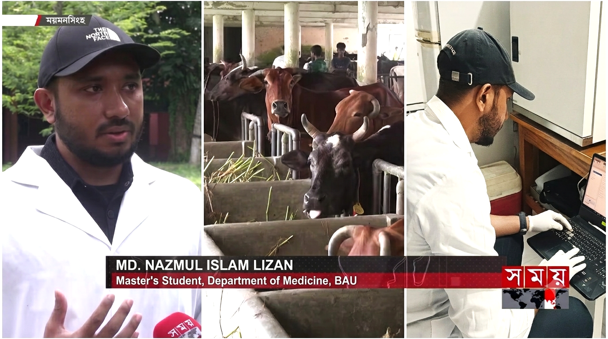

::::: home-layout
::: home-left
       

<h2>Md Nazmul Islam</h2>

DVM · MS Candidate in Medicine

  
<i class="fa-solid fa-location-dot"></i> Bangladesh

  
<a href="https://bau.edu.bd/" target="_blank"><i class="fa-solid fa-building-columns"></i> Bangladesh Agricultural University</a>

  
<a href="mailto:nazmul.1901007@bau.edu.bd"><i class="fa-solid fa-envelope"></i> Email</a>

  
<a href="https://www.linkedin.com/in/md-nazmul-islam-edu/" target="_blank"><i class="fa-brands fa-linkedin"></i> LinkedIn</a>

  
<a href="https://github.com/nazmulislammd" target="_blank"><i class="fa-brands fa-github"></i> GitHub</a>

  
<a href="https://scholar.google.com/citations?user=znn6vX8AAAAJ" target="_blank"><i class="fa-solid fa-graduation-cap"></i> Google Scholar</a>

  
<a href="https://www.researchgate.net/profile/Md-Nazmul-Islam-26" target="_blank"><i class="fa-solid fa-flask"></i> ResearchGate</a>

  
<a href="https://orcid.org/0009-0002-1752-9210" target="_blank"><i class="fa-brands fa-orcid"></i> ORCID</a>

:::

::: home-right

Veterinary epidemiologist using Bayesian models to estimate how livestock diseases spread and where control will work best.

I am a Doctor of Veterinary Medicine (DVM) graduate and an MS candidate in Medicine at the Department of Medicine, Bangladesh Agricultural University.

My research uses Bayesian statistics to answer practical questions about livestock disease: how common an infection really is when diagnostic tests are imperfect, how fast it spreads within herds, where it is likely to go next, and which control measures are worth their cost. Most of my work so far has been on dairy cattle (brucellosis, paratuberculosis, Q fever, neosporosis, bovine viral diarrhoea and subclinical mastitis). My MS thesis now applies these methods to African swine fever in free-ranging pigs.

I work in the Epidemiology &amp; Preventive Medicine Lab under <a href="https://vm.bau.edu.bd/teachers/VM1004" target="_blank"><strong>A.K.M. Anisur Rahman</strong></a>. My work combines farm sampling and laboratory diagnostics (ELISA, PCR) with model building in R and Stan and disease mapping in QGIS.

  Current Research · MS Thesis (In Progress)
  
Bayesian Quantitative Risk Assessment of African Swine Fever Spread among Scavenging Pig Populations in Bangladesh

  
African swine fever (genotype II) reached Bangladesh in 2023 and 2024, where most pigs are kept by marginalised communities in free-ranging and nomadic systems. Following the WOAH risk analysis framework, I am estimating within-herd R₀ from outbreak data, the yearly probability that the virus reaches new districts, how much spread could go undetected, and which controls (border checks, heat-treating swill, faster reporting) would reduce risk most.

  
Master of Science in Medicine · April 2025 – Present · Department of Medicine, Bangladesh Agricultural University 
  Supervisor: <a href="https://vm.bau.edu.bd/teachers/VM1004" target="_blank">Prof. Dr. A.K.M. Anisur Rahman</a> · CGPA 3.80 / 4.00 (first semester)

You can find my publications, research projects, data visualizations and CV through the menu above.

<h2>Key Highlights</h2>
<ul>
  <li><strong>Nine peer-reviewed journal articles</strong> published, three as first or equally contributing first author, and <strong>five manuscripts under review</strong>, including in <em>Epidemics</em>, <em>Preventive Veterinary Medicine</em> and <em>Veterinary Medicine and Science</em>.</li>
  <li>Applied <strong>Bayesian latent-class prevalence estimation, catalytic force-of-infection models, mixture-model test cut-offs and decision-analytic economic models</strong> to six infectious diseases in large Bangladeshi dairy herds.</li>
  <li><strong>Leading an independent global research programme on human brucellosis</strong> with a ten-member team, using Bayesian meta-analysis and spatiotemporal mapping.</li>
  <li>Recipient of the <strong>National Science and Technology (NST) Fellowship 2026</strong>.</li>
</ul>

<h2>Research Coverage</h2>

:::: {.coverage-card}

**Our brucellosis research was featured by Somoy TV, a national television news channel in Bangladesh, and by several national news outlets.** The coverage focused on risk factors, milk-production losses and the economics of control in large commercial dairy herds.

<a href="https://www.youtube.com/watch?v=z-08npz2H74"
   target="_blank"
   rel="noopener noreferrer"
   aria-label="Watch the Somoy TV feature on YouTube">

<i class="fa-solid fa-play"></i>
</a>

::: {.coverage-links}
[Risk-Factor Study](https://doi.org/10.1186/s44149-026-00234-w){target="_blank"}

[Economic Study](https://doi.org/10.1016/j.prevetmed.2026.107014){target="_blank"}

[Somoy TV Feature](https://www.youtube.com/watch?v=z-08npz2H74){target="_blank"}

[JagoNews24](https://www.jagonews24.com/m/campus/news/1140849){target="_blank"}

[Bangla Tribune](https://www.banglatribune.com/country/mymensing/958814/%E0%A6%AF%E0%A7%87-%E0%A6%B0%E0%A7%8B%E0%A6%97%E0%A7%87%E0%A6%B0-%E0%A6%95%E0%A6%BE%E0%A6%B0%E0%A6%A3%E0%A7%87-%E0%A6%97%E0%A6%B0%E0%A7%81-%E0%A6%A6%E0%A7%81%E0%A6%A7-%E0%A6%95%E0%A6%AE-%E0%A6%A6%E0%A6%BF%E0%A6%9A%E0%A7%8D%E0%A6%9B%E0%A7%87-%E0%A6%96%E0%A6%BE%E0%A6%AE%E0%A6%BE%E0%A6%B0%E0%A6%BF%E0%A6%A6%E0%A7%87%E0%A6%B0-%E0%A6%AC%E0%A7%9C){target="_blank"}

[The Daily Campus](https://thedailycampus.com/agri-university/265663){target="_blank"}
:::

::::

<h2>Research Interests</h2>
<ul>
  <li>Veterinary epidemiology and infectious disease transmission dynamics</li>
  <li>Bayesian quantitative risk assessment of transboundary and zoonotic animal diseases</li>
  <li>Diagnostic-test evaluation and surveillance under uncertainty</li>
  <li>Livestock health and production-impact assessment</li>
  <li>One Health in South Asia and other low- and middle-income countries</li>
</ul>
:::
:::::
